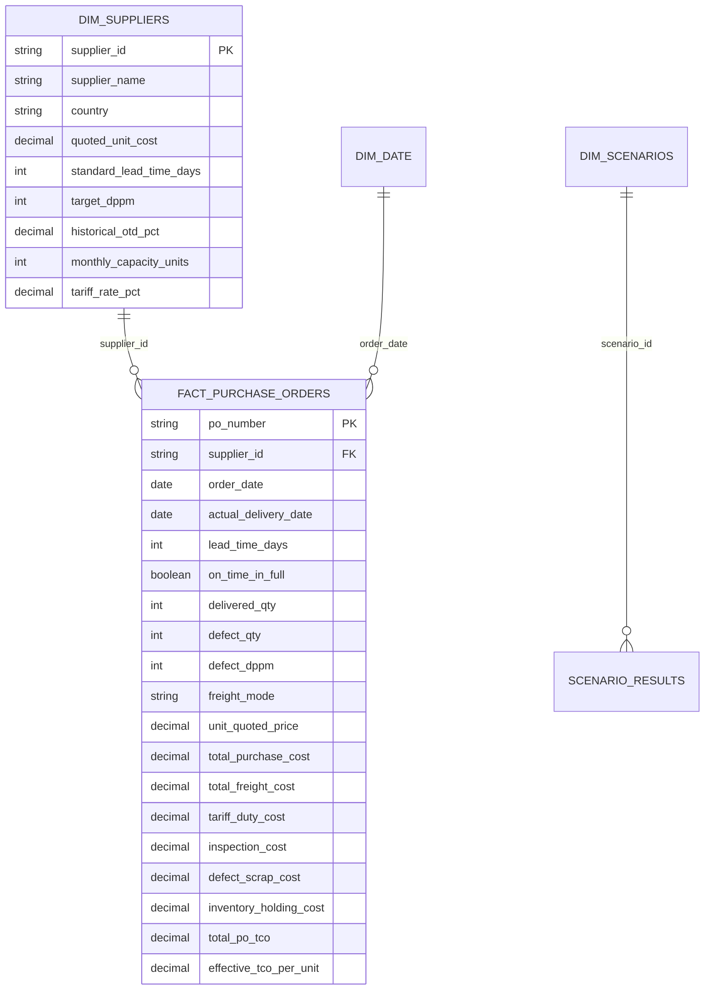

# Power BI Implementation Guide: GSSM Procurement Dashboard

This guide allows you to import the project's synthetic dataset directly into **Microsoft Power BI Desktop**, recreate the enterprise sourcing star-schema, and build an executive-grade dashboard matching Global Sourcing & Supply Management standards.

---

## 1. Data Model & Star-Schema Architecture

Connect Power BI to the CSV files in `TechCorp_GSSM_Procurement_Project/data/` or SQLite `procurement.db`.



### Table Relationships in Power BI:
- `dim_suppliers[supplier_id]` (1) ➔ `fact_purchase_orders[supplier_id]` (*) (One-to-Many, Single Cross-Filter)

---

## 2. Production DAX Measures Library

Create a dedicated measure table called `_ProcurementMeasures` and add the following DAX calculations:

### 1. Total Delivered Units
```dax
Total Units Delivered = 
SUM(fact_purchase_orders[delivered_qty])
```

### 2. Total Purchase Spend (FOB)
```dax
Total Purchase Spend = 
SUM(fact_purchase_orders[total_purchase_cost])
```

### 3. Total Landed TCO Spend
```dax
Total Landed TCO = 
SUM(fact_purchase_orders[total_po_tco])
```

### 4. Effective Landed TCO per Unit
```dax
Landed TCO per Unit = 
DIVIDE([Total Landed TCO], [Total Units Delivered], BLANK())
```

### 5. Quoted Unit Price (Weighted Average)
```dax
Quoted Price per Unit = 
DIVIDE([Total Purchase Spend], [Total Units Delivered], BLANK())
```

### 6. Hidden TCO Premium (Cost Delta per Unit)
```dax
Hidden TCO Premium = 
[Landed TCO per Unit] - [Quoted Price per Unit]
```

### 7. Hidden TCO Markup %
```dax
Hidden TCO Markup % = 
DIVIDE([Hidden TCO Premium], [Quoted Price per Unit], 0)
```

### 8. On-Time In-Full (OTIF) Delivery %
```dax
OTIF Delivery % = 
DIVIDE(
    CALCULATE(COUNTROWS(fact_purchase_orders), fact_purchase_orders[on_time_in_full] = TRUE),
    COUNTROWS(fact_purchase_orders),
    0
)
```

### 9. Weighted Defect DPPM (Defects per Million)
```dax
Weighted Defect DPPM = 
DIVIDE(
    SUM(fact_purchase_orders[defect_qty]),
    [Total Units Delivered],
    0
) * 1000000
```

### 10. Quality Yield %
```dax
Quality Yield % = 
1 - DIVIDE(SUM(fact_purchase_orders[defect_qty]), [Total Units Delivered], 0)
```

### 11. Expedited Air Freight Premium Waste
```dax
Expedited Freight Waste = 
SUMX(
    FILTER(fact_purchase_orders, fact_purchase_orders[freight_mode] = "Air Expedited"),
    fact_purchase_orders[total_freight_cost] - 
    (fact_purchase_orders[delivered_qty] * RELATED(dim_suppliers[standard_freight_per_unit]))
)
```

### 12. Net Sourcing Savings vs Incumbent
```dax
Net Savings vs Incumbent = 
VAR IncumbentTCO = 
    CALCULATE(
        [Landed TCO per Unit],
        dim_suppliers[supplier_name] = "Apex Display Technologies"
    )
RETURN
    (IncumbentTCO - [Landed TCO per Unit]) * [Total Units Delivered]
```

---

## 3. Recommended Power BI Dashboard Layout (3 Pages)

### Page 1: Executive Sourcing Overview
- **Top Header**: GSSM Logo, Slicer for Quarter (`Q1-2025` to `Q4-2025`), Slicer for Origin Country.
- **KPI Cards**:
  1. `[Total Landed TCO]` (e.g. $537M)
  2. `[Landed TCO per Unit]` ($44.17)
  3. `[OTIF Delivery %]` (95.4%)
  4. `[Weighted Defect DPPM]` (1,097)
  5. `[Expedited Freight Waste]` ($1.42M)
- **Visual 1 (Clustered Column Chart)**:
  - Axis: `Supplier Name`
  - Values: `[Quoted Price per Unit]` and `[Landed TCO per Unit]`
  - *Key visual insight: Shows Kestrel jumping from cheapest quote ($37.90) to expensive TCO ($43.50).*
- **Visual 2 (Scatter Plot / Risk Matrix)**:
  - X-Axis: `[Landed TCO per Unit]`
  - Y-Axis: `[Weighted Defect DPPM]`
  - Bubble Size: `[Total Units Delivered]`
  - Details: `Supplier Name`
  - *Reference lines at $44.00 TCO and 1,500 DPPM to show the optimal sourcing quadrant.*

### Page 2: Granular Cost Breakdown & TCO Anatomy
- **Visual 1 (Stacked 100% Bar Chart)**:
  - Axis: `Supplier Name`
  - Values: `Purchase Cost`, `Freight Cost`, `Tariff Duty`, `Inspection Cost`, `Scrap Cost`, `Holding Cost`
  - *Reveals why Kestrel has massive scrap and tariff share compared to Apex and Vanguard.*
- **Visual 2 (Decomposition Tree)**:
  - Analyze: `[Total Landed TCO]`
  - Explain by: `Supplier Country` ➔ `Supplier Name` ➔ `Cost Category` ➔ `Freight Mode`

### Page 3: Supplier Scorecard & Dual-Sourcing Allocation
- **Matrix Visual (Scorecard)**:
  - Rows: `Supplier Name`
  - Values: `Quoted Price`, `Landed TCO`, `OTIF %`, `DPPM`, `Capacity Utilization %`, `Composite Score`
  - Conditional Formatting: Data bars on Composite Score, Color scale on DPPM (Green < 1,000, Red > 3,000).
- **Dual-Sourcing Scenario Table**:
  - Compares Strategy A (Naive 100% Kestrel) vs Strategy B (Incumbent 100% Apex) vs Strategy D (Dual 70% Vanguard / 30% Apex).
