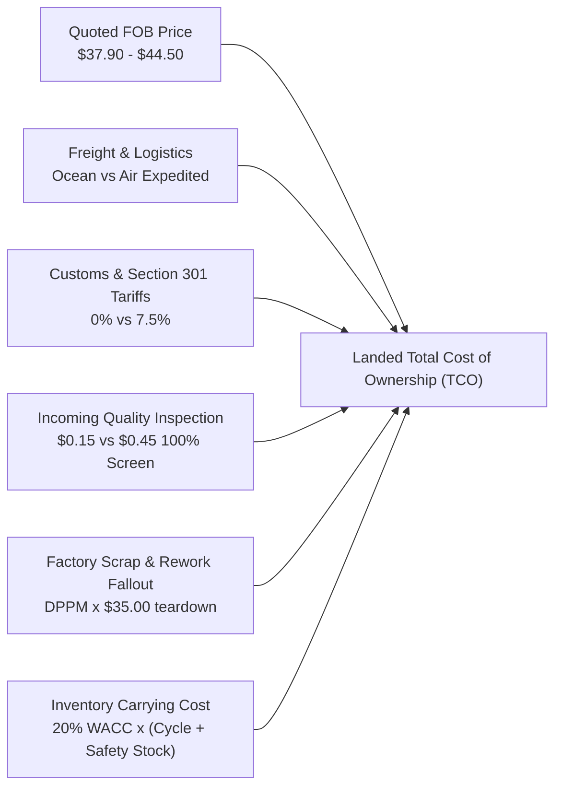

# CONFIDENTIAL | SOURCING DECISION MEMORANDUM

**TO:** Senior Director, Global Procurement & Operations  
**FROM:** Global Sourcing & Supply Management (GSSM) Intern / Sourcing Manager  
**DATE:** Fiscal Year 2025-2026 Sourcing Cycle  
**SUBJECT:** Sourcing Allocation & Total Cost of Ownership (TCO) Optimization: Apollo Pro 6.3" LTPO OLED Display Sub-Assembly  

---

## 1. Executive Summary

This memorandum presents the final sourcing allocation and Total Cost of Ownership (TCO) evaluation for the **Apollo Pro 6.3" LTPO OLED Display Sub-Assembly** (Annual Demand: **12,000,000 units**).

### Primary Decision:
We recommend awarding a **70% / 30% Dual-Sourcing Allocation** to **Vanguard Optoelectronics (Taiwan)** as primary supplier and **Apex Display Technologies (South Korea)** as secondary supplier (**Strategy D**).

### Strategic & Financial Impact:
* **Enterprise Net Savings:** Delivers **$23.38M in verified net enterprise cost savings** relative to the incumbent sole-source baseline (Apex 100%), net of all tooling NRE qualifications ($7.0M total).
* **Defect & Line Reliability:** Maintains a blended quality defect rate of **1,097 DPPM** (below our <1,500 DPPM tier-1 assembly cap) with a **95.4% OTIF delivery rate**.
* **Disruption Protection:** Eliminates single-fab operational dependency by distributing capacity across Taichung, Taiwan and Paju, South Korea, driving the **lowest risk profile (Risk Index 18.2 / 100)** across all evaluated scenarios.
* **Rejection of Naive Lowest Bidder:** We explicitly **reject Kestrel Panel Dynamics (China)** despite their aggressive **$37.90 FOB** quote. Post-landed TCO analysis reveals their true cost is **$43.50/unit** due to Section 301 tariffs, severe defect fallout (5,239 DPPM requiring $35 scrap cost), and emergency air freight expedites, accompanied by an unacceptable line-down risk index of **94.0 / 100**.

---

## 2. Supplier Landscape & Evaluation Matrix

Six tier-1 global display manufacturers were evaluated across 1,450 historical purchase order shipments:

| Supplier Name | Country | Quoted FOB Price | Landed TCO / Unit | Hidden TCO Delta | Defect Rate (DPPM) | OTIF Delivery % | Monthly Capacity | Sourcing Score | Status |
| :--- | :---: | :---: | :---: | :---: | :---: | :---: | :---: | :---: | :---: |
| **Vanguard Optoelectronics** | Taiwan | **$41.20** | **$43.21** | +$2.01 (+4.9%) | 1,250 | 94.2% | 950k | **88.4 / 100** | **Primary (70%)** |
| **Apex Display Tech.** | S. Korea | **$44.50** | **$46.41** | +$1.91 (+4.3%) | 420 | 97.5% | 850k | **86.2 / 100** | **Secondary (30%)** |
| **Lumina MicroOptics** | Japan | $43.80 | $45.84 | +$2.04 (+4.7%) | 580 | 96.0% | 700k | 81.5 / 100 | Qualified Reserve |
| **Solaria Micro-Devices** | Vietnam | $39.80 | $41.90 | +$2.10 (+5.3%) | 2,100 | 91.0% | 650k | 76.3 / 100 | China+1 Ramp (FY27) |
| **Zenith Semiconductor** | Malaysia | $42.10 | $44.39 | +$2.29 (+5.4%) | 1,600 | 89.5% | 500k | 69.8 / 100 | Niche Overflow |
| **Kestrel Panel Dynamics** | China | $37.90 | $43.50 | +$5.60 (+14.8%) | 5,239 | 83.5% | 1,100k | 54.1 / 100 | **REJECTED** |

---

## 3. The Total Cost of Ownership (TCO) Model

Procurement cannot rely on quoted FOB unit price alone. Our TCO model captures six distinct cost components:

$$\text{Landed TCO} = C_{\text{FOB}} + C_{\text{Freight}} + C_{\text{Tariff}} + C_{\text{Inspection}} + C_{\text{Scrap/Rework}} + C_{\text{Holding}}$$



### Deconstructing the Kestrel "Price Trap":
Kestrel Dynamics marketed an aggressive quoted price of **$37.90**, offering an apparent savings of **$6.60/unit ($79.2M enterprise paper savings)** against Apex.

However, granular empirical cost modeling revealed:
1. **Section 301 Tariffs:** +$2.84/unit (7.5% duty on China origin electronics).
2. **Factory Scrap Fallout:** +$0.18/unit direct scrap cost (5,239 DPPM requiring $35 assembly teardown).
3. **Mandatory 100% Lot Screening:** +$0.45/unit metrology inspection cost (vs $0.15 standard sampling) required to protect downstream assembly lines.
4. **Buffer Inventory Carrying Cost:** +$0.48/unit due to an extended 35-day lead time with high variance ($\sigma = 4.8$ days), requiring 18 days of additional safety stock buffer.
5. **Emergency Air Expedites:** Late shipments forced 16.5% of batches onto emergency air freight (+$3.20/unit expedite penalty).

**True Landed TCO:** Kestrel's cost escalated to **$43.50/unit**, obliterating 85% of paper savings while subjecting final assembly plants to unacceptable delivery volatility.

---

## 4. Evaluation of Allocation Strategies

Five allocation strategies were modeled over a 12.0M unit annual run-rate:

```
Strategy A: Naive Lowest-Quote (100% Kestrel)
├─ Enterprise Spend: $525.50M | Net Savings: +$34.92M | Risk Index: 94.0 (CRITICAL RISK)
Strategy B: Incumbent Sole-Source (100% Apex)
├─ Enterprise Spend: $560.42M | Net Savings: $0.00M    | Risk Index: 32.6 (HIGH COST)
Strategy C: 3-Way Equal Split (33% Apex / 33% Lumina / 34% Vanguard)
├─ Enterprise Spend: $552.11M | Net Savings: +$8.31M  | Risk Index: 14.6 (TOOLING OVERHEAD)
Strategy D: RECOMMENDED DUAL-SOURCE (70% Vanguard / 30% Apex)
├─ Enterprise Spend: $537.04M | Net Savings: +$23.38M | Risk Index: 18.2 (OPTIMAL FRONTIER)
Strategy E: China+1 Regional Hedge (65% Vanguard / 35% Solaria Vietnam)
├─ Enterprise Spend: $520.02M | Net Savings: +$40.40M | Risk Index: 26.6 (FUTURE ROADMAP)
```

### Why Strategy D is Optimal:
* **The 70% Share to Vanguard (8.4M units):**
  - Vanguard operates a modern Gen-6 OLED fab in Taichung with 950k monthly capacity.
  - An 8.4M unit allocation represents 73.7% factory utilization—comfortably within the 85% operational sweet spot.
  - Generates the bulk of enterprise savings ($43.21 landed TCO).
* **The 30% Share to Apex (3.6M units):**
  - Keeps Apex warm as a tier-1 qualified partner with active tooling.
  - Guarantees immediate access to Apex's ultra-high yield (420 DPPM) for initial EVT/PVT build ramps.
  - Provides instant surge headroom of +250k units/month if launch demand exceeds forecasts.

---

## 5. Scenario Stress-Testing & Supply Continuity

To test supply resilience under extreme market volatility, three operational shocks were simulated:

| Scenario | Market Conditions | Strategy D (Rec. Dual) | Strategy B (Incumbent) | Strategy A (Kestrel 100%) | Operational Finding |
| :--- | :--- | :---: | :---: | :---: | :--- |
| **1. Baseline Demand** | 12.0M units, normal freight | **$537.0M** | $560.4M | $525.5M | Strategy D saves $23.4M with zero disruption. |
| **2. Launch Surge (+25%)** | 15.0M units ramp in Q3/Q4 | **$678.5M** | $712.0M | $689.0M | **Kestrel breaches capacity (113% util)**; Strategy D absorbs surge seamlessly. |
| **3. Port Bottleneck** | +12 day shipping delay, 2.2x freight | **$558.2M** | $581.4M | $612.8M | Kestrel costs surge by $87M due to emergency air freight. |
| **4. Section 301 Tariff Hike** | +15% tariff on China origin | **$539.1M** | $560.4M | $638.5M | Kestrel completely unviable; Strategy D insulated in Taiwan & Korea. |

---

## 6. Implementation Plan & Sourcing Roadmap

1. **Q1-Q2 (Tooling & Line Qualification):**
   - Release $3.5M tooling PO for Vanguard Taichung Fab 3 line dedicated to Apollo Pro.
   - Deploy Supplier Quality Engineering (SQE) (Supplier Quality Assurance) engineers on-site to reduce Vanguard DPPM from 1,250 to <900.
2. **Q3 (PVT & Initial Ramp):**
   - Execute 60/40 volume split during initial 60 days to leverage Apex’s mature yield during retail launch.
   - Transition to 70/30 once Vanguard passes final Cpk quality gates.
3. **FY2027 Long-Term Strategic Roadmap:**
   - Initiate NPI process audits at Solaria Micro-Devices (Vietnam) to prepare them as a secondary source for FY2027, unlocking an additional **$17.0M in tariff-free Southeast Asian sourcing savings**.
